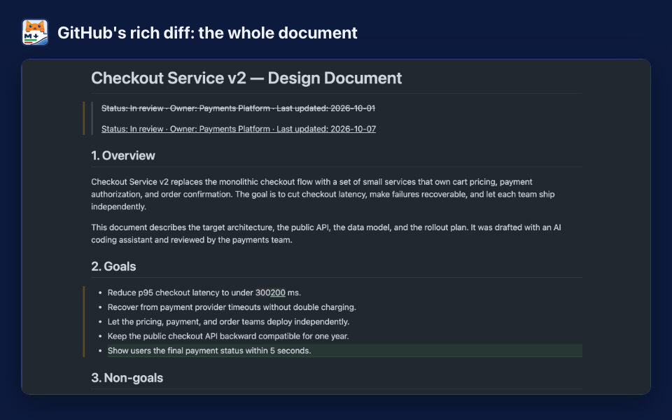
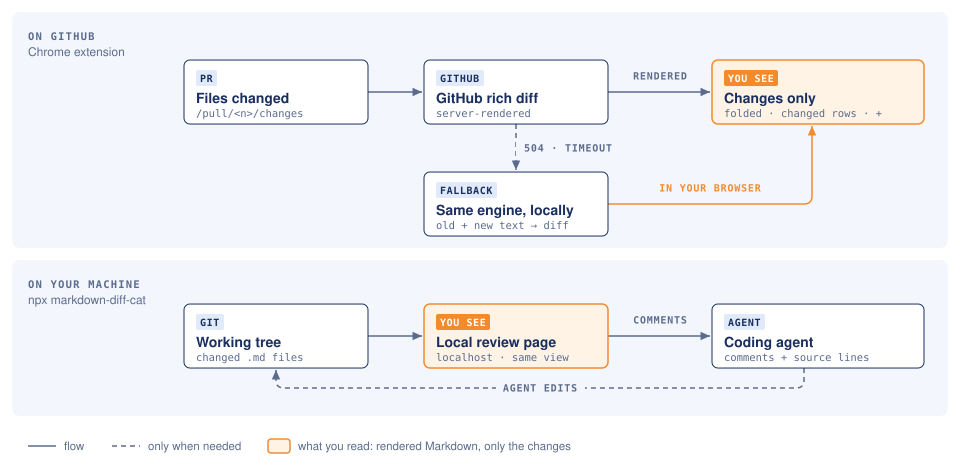
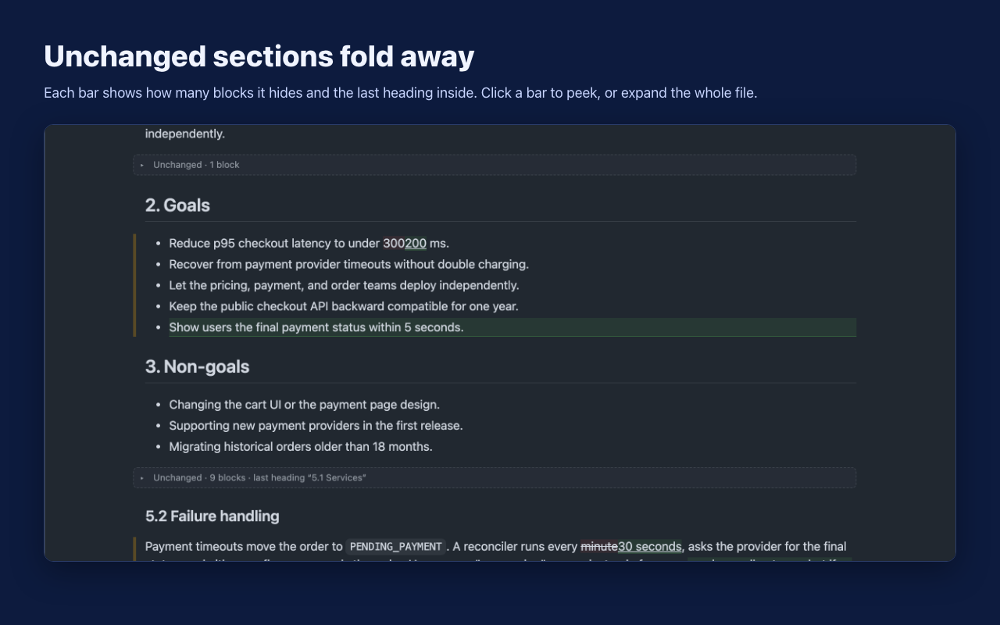
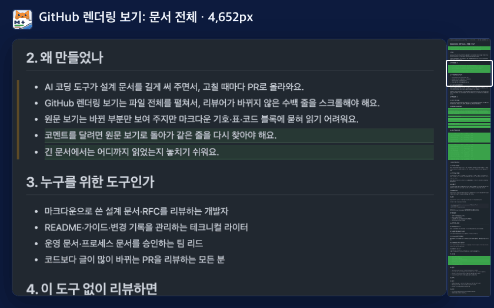
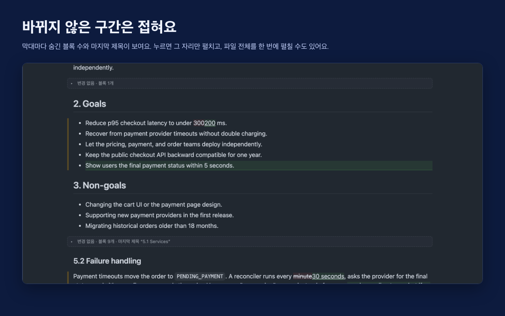

<p align="center"></p>

<h1 align="center">Markdown Diff Cat for GitHub</h1>

<p align="center">See only what changed in Markdown files on GitHub pull requests — rendered, not raw.</p>

<p align="center">
  <a href="https://chromewebstore.google.com/detail/markdown-diff-cat-for-git/kabekbbeoajhpbcppidepmcbbjjochlj"></a>
  <a href="https://www.npmjs.com/package/markdown-diff-cat"></a>
  <a href="LICENSE"></a>
</p>

<p align="center"><a href="#한국어">한국어</a></p>



## Why

AI assistants write long design documents, and reviewing them in a pull request is painful:

- **Rich diff** (the rendered view) shows the whole file. You scroll past hundreds of unchanged lines to find the few that changed.
- **Source diff** shows only the changes, buried in Markdown syntax, table pipes and code fences.

Markdown Diff Cat gives you both: the rendered document, with only the changes in view. It comes as a Chrome extension for pull requests and a command-line tool for the Markdown you change on your own machine.

<picture>
  <source media="(prefers-color-scheme: dark)" srcset="docs/images/overview-dark.svg">
  
</picture>

## What it does

On the "Files changed" page of a pull request, for every `.md`, `.markdown` and `.mdx` file:

- **Rendered, changes only.** It opens the rendered view for you and folds unchanged sections into one-line bars (block count and last heading; click to expand, or **Expand all**).
- **Tables show only the changed rows.** GitHub shows the whole old table and the whole new one; Markdown Diff Cat merges them into one table with the changed, added and removed rows, and changed cells as old → new. **All rows** and **Original tables** switch back.
- **Works when GitHub gives up** (signed in). On some large files GitHub's server times out and shows only "This rich diff is not supported at the moment." The extension then renders the diff in your browser and puts it where GitHub's would be, with a one-line note. If that fails too, you get the source diff and the reason.
- **Jump between changes.** Each file says how many places changed and how many review threads are open ("8 changes · 3 threads (3 open)"). `]` / `[` move between changes on the page, `}` / `{` between threads, ↑ ↓ within a file.
- **Comment in the rendered view** (signed in). Hover a block and click **+**, or drag from **+** to another block for a range. Comments land on the right source line as ordinary GitHub review comments: single comment or review, reply and resolve in place, preview, edit and delete your own. The comment box works like GitHub's, with the formatting toolbar and the **suggestion** button.
- **Stays out of your way.** A file you switch to `<>` (source) stays there until you choose the rich diff again. Collapsed and **Viewed** files stay collapsed. Signed out, files with review comments stay in the source view, where their threads are.
- **One click on or off.** The toolbar icon is in color when on and gray when off. A `!` badge appears only when the page could not be read; hover for the reason.

Works on both "Files changed" pages: the new one for signed-in users (`/pull/<n>/changes`) and the classic one (`/pull/<n>/files`). The extension's text is in English, like GitHub's own pages.



## Install

**[Chrome Web Store — Markdown Diff Cat for GitHub](https://chromewebstore.google.com/detail/markdown-diff-cat-for-git/kabekbbeoajhpbcppidepmcbbjjochlj)** · [Release notes](https://github.com/drum-grammer/GITHUB-MD-DIFF/releases)

With Enhanced Safe Browsing on, Chrome may say "Proceed with caution": the extension comes from a new publisher, and Google usually takes a few months to trust one ([Chrome Web Store Help](https://support.google.com/chrome_webstore/answer/2664769)). Choose **Continue to install**.

<details>
<summary><b>Try a build before it reaches the store (developer mode)</b></summary>

You need Node 22.18 or later and pnpm 12 (`corepack enable` picks the pinned version).

```sh
git clone https://github.com/drum-grammer/GITHUB-MD-DIFF.git && cd GITHUB-MD-DIFF
pnpm install && pnpm dev:chrome
```

1. `pnpm dev:chrome` builds a development copy into `~/.local/share/github-md-diff/chrome-dev` (`GMD_CHROME_DEV_DIR` changes it) and, on macOS, copies that path to the clipboard. `--open` also opens `chrome://extensions`
2. First time only: `chrome://extensions` → **Developer mode** → **Load unpacked** → that folder (`Cmd+Shift+G` to paste on macOS). Turn off the store version while you test
3. After that, run `pnpm dev:chrome` from any branch (`git pull`, or `gh pr checkout <number>` for an open pull request) and reload a GitHub tab. The copy reloads itself; it shows as **Markdown Diff Cat (dev)** with the commit in its version

The self-reload lives in `src/dev/` and never reaches `pnpm build` or `pnpm package`.

</details>

## Local review (outside GitHub)

[`markdown-diff-cat`](packages/review/README.md) shows the same rendered diff for the Markdown you change locally — before you commit, or while a coding agent edits your docs — in a page on your own computer, and hands your block comments to the agent with the exact source lines. It sends nothing outside by default.

```sh
npx -y markdown-diff-cat review                # open the review page for your working tree
npx -y markdown-diff-cat comments              # print your comments for the agent
npx -y markdown-diff-cat review --since-last   # after the agent's edits, only what changed since
```

Needs macOS or Linux, Node.js 22.19 or newer, and git. Commands, agent setup and privacy: [packages/review/README.md](packages/review/README.md).

## Privacy

No data collected and no remote code. The extension reads the open GitHub page in your browser to change how it looks. Signed in, it also talks to GitHub — only GitHub — with the session you already have: it loads review threads and the Markdown files it shows, and posts the comments you write. No token is used and nothing goes to the developer. Its one setting (on or off) stays in `chrome.storage.local`. Permissions: `storage` and `https://github.com/*`. Full policy: [PRIVACY.md](PRIVACY.md).

## Limits

- **Rendering in your browser** uses the local review engine, so it can differ slightly from GitHub: images from other sites and Mermaid diagrams are not drawn (math is drawn by GitHub's page). It needs the signed-in "Files changed" page of the whole pull request, renders one file at a time near the screen, and stops at about 600,000 characters per side. A large file can hold the page for a second; the note appears first. [Design and measurements](docs/local-render/README.md)
- **Edits that don't change the rendering** (Markdown syntax, a link URL, an escaped character) have nothing to highlight. The file says so, with **Show source diff**. Files renamed without changes stay in the source view.
- **Large pull requests:** at most 10 rendered views are requested at a time, files on screen first. Files further down render as you scroll.
- **GitHub's page and requests are not a public API.** Page assumptions live in `src/selectors.ts`, request assumptions in `src/github-api.ts`. When GitHub changes them, the icon shows `!` (and commenting turns itself off, while folding and tables keep working) until an update ships. A note in the corner links to a prefilled issue. A comment that fails to post stays in its box.
- **+** appears only on blocks matched to their source lines. Blocks drawn from HTML or diagrams may not get one; use the source diff for those.

## Develop

| Command | What it does |
|---|---|
| `pnpm test` · `pnpm typecheck` | Unit and DOM tests (vitest + jsdom), type check |
| `pnpm e2e:login`, then `pnpm e2e` | Real Chromium with the extension on public pull requests, signed in and out. `GMD_E2E_WRITE=1` also posts and deletes comments (needs `gh` as the repository owner) |
| `pnpm canary [--notify]` · `pnpm canary:status` | Read-only check of everything the extension relies on, against live GitHub; when it last ran and whether it passed |
| `pnpm testbed:setup`, then `pnpm testbed` | Release scenarios with real comments on the [test repository](https://github.com/drum-grammer/markdown-diff-cat-testbed) ([testbed/README.md](testbed/README.md)) |
| `pnpm explore:pick`, then `pnpm explore` | Read-only exploration of recent Markdown pull requests in public repositories |
| `pnpm perf` | How much the extension slows GitHub down, extension off and on |
| `pnpm --filter markdown-diff-cat <test\|typecheck\|build\|e2e>` | The local review CLI in `packages/review` |
| `pnpm package` · `pnpm release <step>` · `pnpm store:assets` | Store package, publishing through the Chrome Web Store API, store images ([store/README.md](store/README.md)) |

<details>
<summary>Where the code relies on GitHub, and other notes</summary>

- GitHub page assumptions live in `src/selectors.ts` (files, headers, buttons) and `src/prose-markup.ts` (markup inside the rendered diff, re-exported by `src/selectors.ts`); request assumptions only in `src/github-api.ts`. The comment UI is `src/comment-controller.ts`, with `src/comments.ts` as its GitHub backend. Tests and scripts share the selectors through `GITHUB_CSS` (`scripts/page-css.mjs`, which Node reads directly — keep the `.ts` extension on imports in `src/selectors.ts`). When GitHub changes its page, follow [docs/runbooks/github-ui-change.md](docs/runbooks/github-ui-change.md)
- `pnpm canary` checks signed-in pull request data, file text, auto rich diff, folding, merged tables, **+** on the right line, matching rate, GitHub's class name format and the signed-out page; exit code 1 when something broke, log in `~/.cache/github-md-diff/canary.log`. `canary:status` exits 1 if it has not run for 2 days or the last run broke
- `node scripts/mapping-report.mjs <pull request URL>…` (after `pnpm build`) reports how many rendered blocks match their source lines
- `pnpm icons` regenerates the PNG icons from `static/icons/*.svg` (commit the PNGs)
- Test fixtures come from public repositories or are handmade; the first line records the source (`test/fixtures.test.ts` checks it)

</details>

### Verification tiers

One command per tier. Each runs its steps in order, keeps going after a failure, and writes a report to `.scratch/verify/<date-time>-<tier>/report.md`; the exit code is 1 when anything failed.

| Tier | When | Steps | Time |
|---|---|---|---|
| `pnpm verify quick` | While you work | typecheck, unit tests, build, test repository setup, read-only `@quick` scenarios | about 45 s |
| `pnpm verify pr` | Before merging a pull request | + end-to-end tests with writes, canary, every test repository scenario (Split layout), local review CLI | about 6–8 min |
| `pnpm verify release` | Before asking the store for review | + all five GitHub diff layouts, re-exploration of 16 public pull requests, performance, store package | about 16–19 min |

`pnpm verify --list` prints the steps; `--bail` stops at the first failure and `--skip step,…` leaves steps out. `pr` and `release` post real comments to the test repository and need `gh` and the signed-in test profile. `release` turns on the Minimize comments and Compact line height account settings for its run and restores them.

## Roadmap

[ROADMAP.md](ROADMAP.md) says where development stands and what comes next (Korean, with an English summary). As of 2026-10-23 the Chrome Web Store, GitHub Releases and npm all have **1.6.0**.

## Research and test reports

Each report is in Korean with an English summary at the top.

| Date | Report | What it found |
|---|---|---|
| 2026-10-22 | [Rendering in the browser when GitHub cannot](docs/local-render/README.md) | GitHub's server times out (504, after about 10 seconds) on some large files — size alone does not decide it: a 437 KB file failed every time while a 261 KB one rendered in 2 seconds. 1.6.0 renders such files in the browser with the local review engine; the two documents that failed render 1–2 seconds after the 504 |
| 2026-10-14 | [1.5.1: GitHub class names](docs/reports/v1.5.1-github-class-names.md) | GitHub renamed the CSS module classes on its signed-in page right after 1.5.0 shipped, and 1.5.0 stopped silently. 1.5.1 finds files by anchor id and structure first, accepts both formats, and warns when it cannot read any file |
| 2026-10-09 | [1.3.0 testing](docs/reports/v1.3.0-testing.md) | Test repository v2 in five diff layouts: 1.2.0 passed 51 of 57 (comments on the whole file were missing), 1.3.0 passes 60 of 60 |
| 2026-10-08 | [1.1.1 test repository](docs/reports/v1.1.1-testbed.md) | Scenarios that post real comments and read them back through the API; the first run found mid-document footnotes without **+** |
| 2026-10-08 | [1.1.1 verification](docs/reports/v1.1.1-verification.md) | 300 Markdown pull requests in 128 public repositories: false alerts 3 → 0, source-line matching 98.4% → 99.7%, extension CPU 1,182 → 220 ms on a 334-file pull request |
| 2026-10-08 | [Similar extensions](docs/reports/competitors.md) | Eight Chrome extensions for Markdown diffs; only this one folds unchanged sections and merges changed table rows |

What the code relies on:

- **GitHub's own requests.** Threads, comments, replies, resolve, edit, delete and preview all use the internal requests of GitHub's "Files changed" page, with your session and no token. A thread's position is a key in the file summary: `R12` (new file, line 12), `L4` (original file) or `FILE`
- **Diff layouts.** Split, Unified and Hide whitespace can be forced through the URL (`?diff=`, `?w=1`); Minimize comments and Compact line height are account settings only. The rendered view behaves the same in all five
- **GitHub's own failures look like ours.** Rendering timeouts (504), loading skeletons below the screen, and large diffs behind **Load Diff** are treated as normal, not as page changes
- **Speed.** Since 1.1.1, folding lands in the same frame as GitHub's rendered diff, and later versions stay within run-to-run noise (`pnpm perf`)

More: [test repository](https://github.com/drum-grammer/markdown-diff-cat-testbed) ([#4 review scenarios](https://github.com/drum-grammer/markdown-diff-cat-testbed/pull/4) · [#5 large diff](https://github.com/drum-grammer/markdown-diff-cat-testbed/pull/5) · [#6 120 files](https://github.com/drum-grammer/markdown-diff-cat-testbed/pull/6) · [#7 follow-up commit](https://github.com/drum-grammer/markdown-diff-cat-testbed/pull/7)) · release notes [v1.7.0](docs/releases/v1.7.0.md) · [v1.6.0](docs/releases/v1.6.0.md) · [v1.5.1](docs/releases/v1.5.1.md) · [v1.5.0](docs/releases/v1.5.0.md) · [v1.1.1](docs/releases/v1.1.1.md) · [not yet released](docs/releases/UNRELEASED.md) · maintainer's private summaries ([research and tests](https://claude.ai/artifact/X8tNysv7MhgaKZocWzaPNx), [1.1.1 verification](https://claude.ai/artifact/9dxHzJFADpAqSk6U4HMjT3))

## Thanks

The request shapes for commenting were first written up by [Markdown PR](https://github.com/chienyuanchang/rich-diff-comments) and [Mihiraki](https://github.com/KinjiKawaguchi/mihiraki) (both MIT).

## License

[MIT](LICENSE). Unofficial. Not affiliated with or endorsed by GitHub. GitHub is a trademark of GitHub, Inc.

---

## 한국어



### 왜 만들었나

AI가 설계 문서를 길게 써 주면서 PR에서 마크다운을 리뷰하기가 힘들어졌어요.

- **렌더링 보기(rich diff)** 는 파일 전체를 펼쳐요. 바뀐 몇 줄을 찾으려고 수백 줄을 스크롤해야 해요.
- **원문 보기(source diff)** 는 바뀐 부분만 보여 주지만, 마크다운 기호·표 구분선·코드 블록에 묻혀요.

Markdown Diff Cat은 둘을 합쳐 **렌더링된 문서에서 바뀐 부분만** 보여 줘요. PR에서는 크롬 확장으로, 내 컴퓨터에서 고친 마크다운은 명령줄 도구로 써요(위 그림).

### 이런 걸 해요

PR의 "Files changed" 화면에서 `.md`·`.markdown`·`.mdx` 파일마다:

- **렌더링해서 바뀐 곳만** — 렌더링 보기로 자동으로 바꾸고, 바뀌지 않은 구간은 한 줄 막대로 접어요(숨긴 블록 수·마지막 제목, 누르면 펼침, **모두 펼치기**)
- **표는 바뀐 행만** — 옛 표와 새 표를 바뀐·추가·삭제 행만 남긴 표 하나로 합치고, 바뀐 칸은 이전 → 이후로 보여 줘요. **전체 행**·**원래 표**로 되돌려 볼 수 있어요
- **GitHub가 못 그려도 보여 줘요**(로그인) — 큰 파일에서 GitHub 서버가 시간 초과로 "This rich diff is not supported at the moment."만 남기면, 확장이 브라우저 안에서 렌더링 diff를 그려 그 자리에 넣고 한 줄로 알려요. 그것도 안 되면 원문 diff와 까닭을 보여 줘요
- **바뀐 곳 사이를 오가기** — 파일 맨 위에 바뀐 곳 수와 미해결 스레드 수("8 changes · 3 threads (3 open)"). `]`·`[`로 바뀐 곳, `}`·`{`로 스레드, ↑ ↓로 파일 안에서 움직여요
- **렌더링 보기에서 바로 코멘트**(로그인) — 블록에 마우스를 올려 **+**, 다른 블록까지 끌면 범위. 맞는 원문 줄에 붙는 보통의 GitHub 리뷰 코멘트예요. 단일·리뷰, 답글·해결, 미리보기, 내 코멘트 편집·삭제, 서식 도구 막대와 **제안**(suggestion) 버튼까지 GitHub 상자와 같아요
- **방해하지 않아요** — `<>`(원문)로 바꾼 파일, 접어 둔 파일·**Viewed** 파일은 그대로 둬요. 로그아웃 상태에서 리뷰 코멘트가 있는 파일은 스레드가 보이는 원문 보기로 둬요
- **한 번에 켜고 끄기** — 툴바 아이콘이 컬러면 켜짐, 회색이면 꺼짐. 화면을 못 읽었을 때만 `!` 배지가 떠요

새 화면(`/pull/<n>/changes`)과 옛 화면(`/pull/<n>/files`) 모두에서 돌아요. 확장 문구는 GitHub 화면처럼 영어예요.



### 설치

**[크롬 웹 스토어 — Markdown Diff Cat for GitHub](https://chromewebstore.google.com/detail/markdown-diff-cat-for-git/kabekbbeoajhpbcppidepmcbbjjochlj)** · [릴리스 노트](https://github.com/drum-grammer/GITHUB-MD-DIFF/releases)

향상된 세이프 브라우징을 켜 두었다면 "주의해서 진행하시기 바랍니다" 창이 뜰 수 있어요. 새 게시자의 확장이라서예요(Google은 보통 몇 달 걸린다고 안내해요, [고객센터](https://support.google.com/chrome_webstore/answer/2664769?hl=ko)). **설치 계속**을 누르면 돼요. 스토어에 나가기 전 빌드를 개발자 모드로 써 보는 법은 위 [Install](#install)에 있어요.

### 로컬 리뷰(GitHub 밖)

[`markdown-diff-cat`](packages/review/README.md)은 내 컴퓨터에서 고친 마크다운(커밋 전, 또는 코딩 에이전트가 문서를 고치는 동안)을 같은 렌더링 diff로 로컬 페이지에 보여 주고, 블록 코멘트를 정확한 원문 줄과 함께 에이전트에게 넘기는 명령줄 도구예요. 기본으로는 바깥에 아무것도 보내지 않아요.

```sh
npx -y markdown-diff-cat review                # 작업 트리 리뷰 페이지 열기
npx -y markdown-diff-cat comments              # 에이전트에게 줄 코멘트 출력
npx -y markdown-diff-cat review --since-last   # 에이전트가 고친 뒤, 지난 리뷰 이후 바뀐 것만
```

macOS 또는 Linux, Node.js 22.19 이상, git이 있어야 해요. 명령·에이전트 설정·개인정보는 [packages/review/README.md](packages/review/README.md)에 있어요.

### 개인정보

수집하는 데이터와 원격 코드가 없어요. 열린 GitHub 페이지를 브라우저 안에서 읽어 보여 주는 모양만 바꿔요. 로그인한 경우에는 이미 있는 세션으로 GitHub하고만 통신해요 — 리뷰 스레드와 보여 주는 마크다운 파일을 읽고, 내가 쓴 코멘트를 올려요. 토큰을 쓰지 않고 개발자에게 아무것도 보내지 않아요. 설정 하나(켜짐·꺼짐)만 `chrome.storage.local`에 둬요. 전문: [PRIVACY.md](PRIVACY.md).

### 로드맵·조사·테스트

어디까지 왔고 다음에 무엇을 할지는 [ROADMAP.md](ROADMAP.md)에 있어요. 2026-10-23 기준으로 크롬 웹 스토어·GitHub Releases·npm 모두 **1.6.0**이에요.

| 날짜 | 보고서 | 찾은 것 |
|---|---|---|
| 2026-10-22 | [GitHub가 못 그린 마크다운을 브라우저에서](docs/local-render/README.md) | GitHub 서버는 일부 큰 파일에서 약 10초 뒤 504로 끊어요. 크기만으로 정해지지 않아요(437 KB는 늘 실패, 261 KB는 2초). 1.6.0은 그런 파일을 브라우저에서 그리고, 실패하던 두 문서가 504 뒤 1–2초에 보여요 |
| 2026-10-14 | [1.5.1: GitHub 클래스 이름](docs/reports/v1.5.1-github-class-names.md) | 1.5.0 게시 직후 GitHub가 로그인 화면의 클래스 이름을 바꿔 1.5.0이 조용히 멈췄어요. 1.5.1은 앵커 id·구조로 먼저 찾고, 두 형식을 다 받고, 파일을 못 읽으면 알려요 |
| 2026-10-09 | [1.3.0 테스트](docs/reports/v1.3.0-testing.md) | 테스트 저장소 v2를 화면 모양 5가지로: 1.2.0은 51/57(파일 전체 코멘트가 안 보임), 1.3.0은 60/60 |
| 2026-10-08 | [1.1.1 테스트 저장소](docs/reports/v1.1.1-testbed.md) | 실제로 코멘트를 쓰고 API로 다시 읽기 — 첫 실행에서 문서 중간 각주에 **+**가 없는 버그를 찾음 |
| 2026-10-08 | [1.1.1 검증](docs/reports/v1.1.1-verification.md) | 공개 저장소 128개의 PR 300개 — 오탐 3 → 0, 원문 줄 연결 98.4% → 99.7%, md 334개 PR에서 확장 CPU 1,182 → 220ms |
| 2026-10-08 | [비슷한 확장 비교](docs/reports/competitors.md) | 8개 비교 — 바뀌지 않은 구간 접기·표 바뀐 행 합치기는 이 확장뿐 |

GitHub와 관련 없는 비공식 도구이며 GitHub의 보증을 받지 않았습니다. GitHub는 GitHub, Inc.의 상표입니다.
