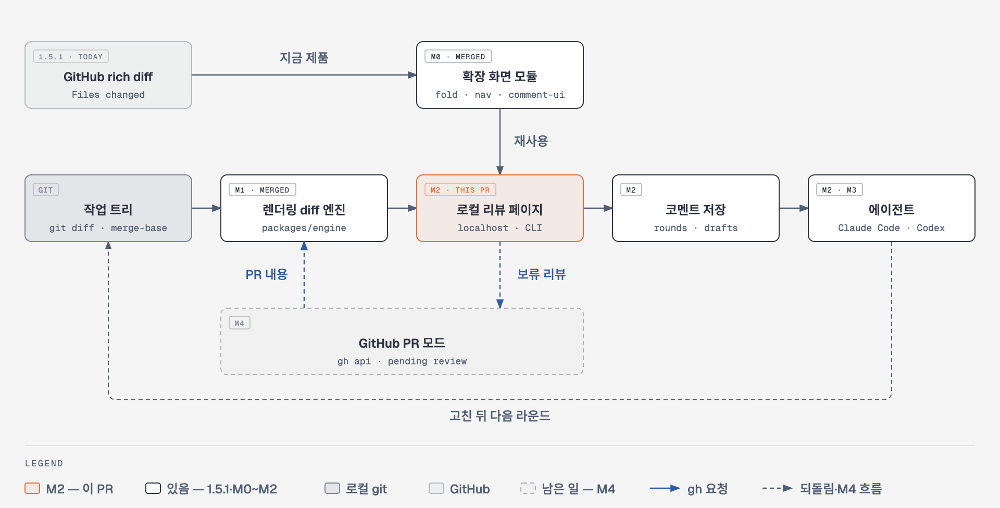
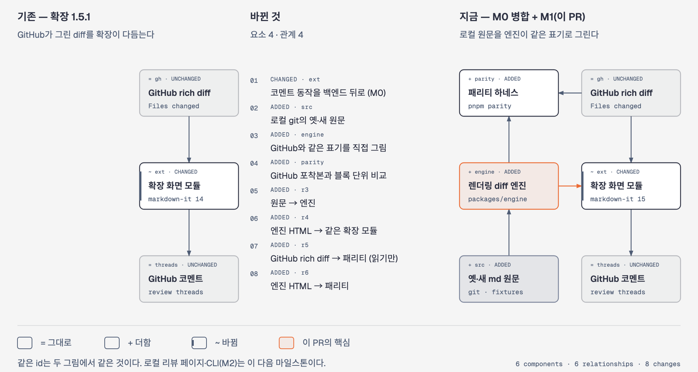
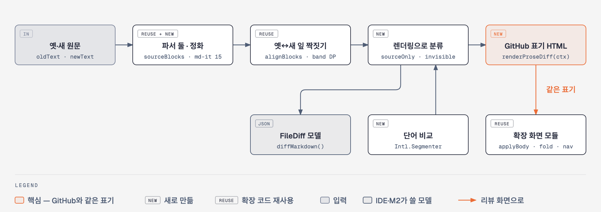

# 로컬 리뷰 — GitHub PR 밖에서 렌더링 마크다운 diff를 보고 코멘트하기

> 최종 확인 2026-10-18 · [ROADMAP](../../ROADMAP.md) · 엔진: [packages/engine](../../packages/engine/README.md) · GitHub와 받아들인 차이: [KNOWN-DIFFERENCES](../../packages/engine/parity/KNOWN-DIFFERENCES.md)

이 문서는 로컬 리뷰의 설계, 지금까지 만든 것, 남은 일을 한곳에 모은 기록이다. 마일스톤 PR이 병합될 때마다 **2. 지금 어디까지 왔나**와 **6. 남은 일**을 같은 PR에서 고친다.

## 0. 한 줄로

코딩 에이전트가 고친 `AGENTS.md`·`SKILL.md`·문서 같은 마크다운을, PR을 열기 전에 **내 컴퓨터에서** GitHub rich diff와 같은 렌더링 diff로 보고, 블록에 코멘트를 달아 에이전트에게 넘기는 도구를 만든다.

크롬 확장(1.5.1)은 GitHub PR "Files changed" 화면에서만 돈다. GitHub가 그린 rich diff를 확장이 다듬는 방식이라, GitHub에 올리기 전의 변경에는 쓸 수 없다. 로컬 리뷰는 같은 화면(접기·표 합치기·이동·코멘트 상자)을 로컬 git 변경에 그대로 쓰게 한다.

## 1. 전체 설계



[그림 HTML](diagrams/overview.html)

| 부분 | 맡은 일 | 있는 곳 |
|---|---|---|
| 렌더링 diff 엔진 | 옛·새 마크다운 원문 → 블록 diff 모델(`FileDiff`) + GitHub rich diff와 같은 표기의 HTML | [`packages/engine`](../../packages/engine/README.md) — **M1** |
| 확장 화면 모듈 | 접기(`fold`)·표 합치기(`table`)·이동(`nav`)·코멘트 상자(`comment-ui`)·코멘트 동작(`CommentController`) | `src/` — 확장과 같이 쓴다(**M0**에서 확장 밖에서도 쓰게 떼어 냄) |
| 로컬 리뷰 페이지 + CLI | 로컬 서버가 엔진 HTML을 페이지로 보여 주고, 확장 화면 모듈로 접기·코멘트를 붙인다 | `packages/review` — **M2** |
| 코멘트 저장 | 라운드·보낸 코멘트·임시 글을 `.git` 밖 사용자 상태 폴더에 | **M2** |
| 에이전트에게 넘기기 | 코멘트를 정해진 형식으로 에이전트(Claude Code)에게, 고친 뒤 `--since-last`로 다음 라운드 | **M2**(Claude Code) · **M3**(Codex 주석) |
| GitHub PR 모드 | `gh`로 PR 내용을 받아 같은 페이지에서 보고, 코멘트는 보류 중 리뷰(pending review)에 올린다 — 공개는 사람이 GitHub에서 | **M4** |

설계의 중심은 **엔진이 GitHub와 같은 표기의 HTML을 낸다**는 것이다. 그러면 확장이 GitHub 화면에서 쓰던 접기·표 합치기·이동·코멘트 코드를 다시 쓰지 않고 그대로 쓸 수 있고, 로컬에서 본 모양과 PR에서 볼 모양이 같다. 그래서 새로 만드는 것은 엔진과 페이지·서버·CLI뿐이다.

## 2. 지금 어디까지 왔나 (2026-10-18)

설계만 한 것이 아니다. 확장 리팩터(M0)와 엔진(M1)은 병합됐고, 사람이 실제로 쓰는 도구(M2)는 구현을 끝내 PR이 열려 있다(브랜치 `feat/local-review-m2`).

| 마일스톤 | 무엇 | 상태 |
|---|---|---|
| **M0** | 확장 리팩터(동작 그대로) — markdown-it 15, 공용 타입(`src/types.ts`)·렌더링 표기(`src/prose-markup.ts`), `align` 한도 인자, `i18n` 밖에서 쓰기, `comment-ui` 옵션, `comments.ts`의 화면 동작을 `CommentController` + `CommentBackend`로 분리, `packages/*` 워크스페이스 | ✅ **병합** — [#47](https://github.com/drum-grammer/GITHUB-MD-DIFF/pull/47)(2026-10-17). 관문: `pnpm verify pr` 7/7, 연결률 기준선 그대로 |
| **M1** | 렌더링 diff 엔진 `packages/engine` + GitHub 패리티 하네스(`pnpm parity`·`parity:capture`·`parity:setup`) + 정화 | ✅ **병합** — [#48](https://github.com/drum-grammer/GITHUB-MD-DIFF/pull/48)(2026-10-17). 시험 670개(엔진 272) · 패리티 87.0% · 줄 속성 빠짐 0 · `pnpm verify pr` 7/7 |
| **M2** | 작업 트리 모드 — `packages/review`(CLI·로컬 서버·리뷰 페이지·코멘트 저장·에이전트에게 넘기기·skill) + npm 게시 | 🔵 **PR 열림** — 브랜치 `feat/local-review-m2`. M2 전 수정 5개 끝 · 패리티 91.1% · `pnpm verify pr` 10/10 · Claude Code 데스크톱 실기(2026-10-20) |
| **M3** | Codex 주석 속성 + Codex용 skill | ⬜ |
| **M4** | GitHub PR 모드(`review --pr`) | ⬜ |
| 다음 | VS Code 확장 → JetBrains 플러그인 | ⬜ 따로 설계 |

M1 끝에 정한 값(패리티 첫 보고서 근거):

| 값 | 정한 것 | 근거 |
|---|---|---|
| 목표 패리티 일치율 | **87%** — M2 끝 보고서가 이 이상이어야 MVP 완료 | 정한 기본값으로 잰 첫 보고서 87.0%(168/193 블록, 포착본 23개) |
| 단어 표시 기준 비율 | **0.45** — 블록의 낱말이 45%를 넘게 바뀌면 단어 표시 없이 옛·새 블록을 통째로 | GitHub 포착본의 단어 표 27행 중 24행과 같음(0.6은 22행) |
| 짝짓기 한도 `gapCells` | **250,000** | 문단 1,000개 + 한 문단 추가도 모두 "고침"으로 짝, 시간 차 20% 안 |

## 3. 기존과 지금



[그림 HTML](diagrams/delta.html)

| | 기존 — 확장 1.5.1 | 지금 — M0 + M1 |
|---|---|---|
| 렌더링 diff를 누가 그리나 | GitHub(서버가 그린 rich diff) | GitHub 화면은 그대로 GitHub, 로컬 원문은 **엔진**이 같은 표기로 |
| 확장 화면 모듈 | 확장 안에서만, GitHub 화면 전용 | 같은 모듈을 엔진 HTML에도 — 엔진 불변식 시험이 `applyBody`·접기·표 합치기·이동이 엔진 HTML에서 도는지 매번 본다 |
| 코멘트 동작 | `comments.ts` 한 덩어리(GitHub API에 묶임) | `CommentController` + `CommentBackend` — 확장은 GitHub 백엔드, M2 페이지는 로컬 백엔드를 끼운다 |
| markdown-it | 14 | 15(엔진과 같은 판) |
| 블록 ↔ 원문 줄 | GitHub 화면의 글자를 원문과 맞춰 찾는다(`mapBlocks`) | 엔진이 잎마다 `data-mdc-new`·`data-mdc-old`를 직접 단다(맞출 필요 없음) |
| GitHub와 같은지 확인 | — | 패리티 하네스 — 공개 testbed PR의 rich diff를 읽기만 해서 고정 자료로 받고 엔진 HTML과 블록 단위로 견준다 |
| 확장 동작·버전 | 1.5.1 | **그대로**(1.5.1, 스토어 zip에 엔진 파일 0개) |

## 4. 엔진 안쪽



[그림 HTML](diagrams/engine.html)

1. **파서 둘** — 잎 블록(문단·제목·항목·표 행·코드)은 확장이 GitHub 화면에서 쓰는 플러그인 없는 기본 파서(`sourceBlocks`)로, 렌더링은 할 일·알림·각주·KaTeX·이모지 플러그인을 켠 markdown-it 15로 따로 얻고 원문 줄 범위로 잇는다. 잎이 없는 블록(구분선·HTML·수식·링크 정의)은 의사 잎으로 둔다.
2. **정화** — 원문 HTML(`html_block`·`html_inline`)만 DOMPurify + jsdom으로 거른다. 엔진 표기(`class`·`data-*`·`oai-*`)를 흉내 내는 속성, `on*`, 스크립트·폼·svg, `javascript:`·`data:` 주소를 지우고, `id`·`name`에는 `user-content-`를 붙이고, 사용자 `<ins>`·`<del>`은 `span`으로 바꾼다. 브라우저가 숨기는 HTML(`hidden`·`popover`·`<title>`·미디어 대체 내용)은 보이게 한다.
3. **짝짓기** — 옛·새 잎을 확장의 `alignBlocks`로 짝짓되 한도를 키우고, 그래도 큰 틈은 제목 경계로 쪼개고, 같은 개수면 1:1, 개수가 다르면 대각선 띠 안에서 짝짓는다. 긴 절의 모든 문단을 조금씩 고쳐도 "지움 + 추가"로 무너지지 않는다.
4. **렌더링으로 분류** — 원문이 아니라 정화된 렌더링 HTML로 같음·바뀜을 정한다. `*b*`→`_b_`처럼 원문만 바뀐 것은 `sourceOnly`, 링크 주소처럼 보이는 글은 같은데 렌더링이 다른 것은 `invisible`이다.
5. **원문만 바뀜 막대** — 렌더링에 안 보이는 변경(숨긴 HTML 주석 지시·양방향 제어 문자·태그 문자·링크 주소 바꿈)은 그 자리에 "Source changed — not visible in the rendering" 막대를 달고, 누르면 원문 줄 diff가 펼쳐진다. 리뷰 화면에서 이런 변경이 접혀 사라지면 에이전트 지시 파일에 숨은 지시가 리뷰를 피해 들어갈 수 있기 때문이다.
6. **GitHub 표기 HTML** — `rich-diff-level-zero`·`vicinity`·`div.expandable.unchanged`·`div.changed`·`ins`/`del`, 표는 옛 `<del>` + 새 `<ins>`, 각주는 문서 끝 한 곳. 모든 코멘트 블록에 원문 줄 속성을 단다. 단어 비교는 `Intl.Segmenter`로 낱말을 나눠 문장부호·이모지도 한 단위로 본다.

공개 API(계약): `diffMarkdown(input, opts?) → FileDiff` · `renderProseDiff(diff, ctx) → string` · `renderMarkdown(text) → string`. 자세한 것은 [packages/engine/README](../../packages/engine/README.md).

**어떻게 지키나** — 사례마다 불변식 넷을 자동으로 건다: ① `git diff`의 hunk마다 확장이 접기까지 끝낸 화면에 보이는 표시가 하나 이상 있다(감싸기만 하는 `div.changed`나 보이는 글 없는 표시는 세지 않는다) ② 모든 코멘트 블록에 줄 속성 ③ 브라우저 파서로 다시 읽어도 같은 HTML ④ 접기 막대·합친 표·이동 대상 수가 모델에서 계산한 값과 같다.

## 5. GitHub 패리티

엔진 HTML이 GitHub rich diff와 블록 단위로 같은지 잰다.

- `pnpm parity:setup --confirm` — 공개 testbed 저장소에 패리티 전용 브랜치(`parity/base`·`parity/head`, 지어낸 Lantern 문서 16개)와 초안 PR([testbed#8](https://github.com/drum-grammer/markdown-diff-cat-testbed/pull/8))을 맞춘다. testbed의 `FIXTURE_VERSION`과 섞이지 않는다.
- `pnpm parity:capture` — 로그인 테스트 프로필로 testbed PR의 rich diff를 **읽기만** 해서 `packages/engine/test/parity/<시나리오>/`에 고정 자료로 저장한다.
- `pnpm parity` — 네트워크 없이 고정 자료와 엔진 HTML을 (표시, 종류, 정규화 글자)로 견주고 `.scratch/parity/report.md`를 쓴다.

첫 보고서: **87.0%**(168/193) · 줄 속성 빠짐 0 · `mapBlocks` 교차 확인 불일치 1(같은 제목 둘 — 엔진 줄 속성이 맞다). M2 전 수정(바뀐 코드·Mermaid 블록, 알림 종류 변경) 뒤 **91.1%**(173/190) — 알림·Mermaid·공백·handbook 시나리오가 100%가 됐다. 남은 차이 가운데 받아들인 것은 [KNOWN-DIFFERENCES](../../packages/engine/parity/KNOWN-DIFFERENCES.md)에 적었다. 포착본으로 두 미확인도 정했다 — 목록 변경은 `div.changed > ul > li.*`(감싼 모양), `www.` 자동 링크는 링크로 그린다.

## 6. 남은 일

**M2 전에 막을 것** — ✅ 모두 끝(M2 Task 0·13):

1. ✅ `CommentController.refresh()` 둘이 같은 틱에 겹치면 스레드 상자가 두 번 그려진다 — 세대 카운터로(M0 검토, 빠른 로컬 백엔드에서 닿는다) · 732fa1b
2. ✅ 동기로 던지는 `mapping()`이 처음 그리기에서 unhandled rejection이 된다 — `Promise.resolve().then(…)`으로(M0 검토) · 732fa1b
3. ✅ 바뀐 코드·Mermaid 블록을 GitHub처럼 바뀐 블록 하나로(`div.changed > pre.rich-diff-level-one`, 안에 줄 단위 `<ins>`·`<del>`) — 전에는 옛 `<del>` + 새 `<ins>`(패리티) · 518194c
4. ✅ 알림 종류를 바꾸면(WARNING→CAUTION) GitHub처럼 옛 제목 `<del>` + 새 제목 `<ins>`, 본문은 변경 없음으로(패리티) · 518194c
5. ✅ 고친 잎의 옛 사본(`.removed`)은 `data-mdc-new`·`data-mdc-old`를 둘 다 단다 — 로컬 백엔드는 `REMOVED_BLOCK`으로 왼쪽(옛) 쪽을 고른다(M1 검토) · Task 13 시험

**M2 — 작업 트리 모드**(`packages/review`, 브랜치 `feat/local-review-m2`):

- CLI `markdown-diff-cat` — `review`(리뷰 페이지 열기)·`comments`(넘기기 형식으로 코멘트 읽기)·`wait`·`mark`·`rev`·`show`·`--since-last`(지난 라운드 뒤 바뀐 것만)
- `git.ts`(기준·파일 목록·내용, 읽기만) · `state.ts`(`.git` 밖 상태 폴더 — 렌더 판 고정·정리, 라운드·보낸 것·표시·임시 글) · `handoff.ts`(에이전트에게 넘기는 형식)
- 로컬 서버 보안 — `127.0.0.1`·`::1`에만, Host 검사, 1회용 코드 → 세션 비밀, Origin 검사, CSP, `/file/<id>`(저장소 안 이미지만), 쓰지 않으면 스스로 종료
- 리뷰 페이지 — 엔진 HTML + `applyBody` + `CommentController` + 로컬 백엔드 + 기준 고르기 + 보내기, 페이지 자산(github-markdown-css + Primer 토큰, 바깥 요청 없음)
- skill `markdown-diff-review`(Claude Code) — 설치·점검 명령
- 시험 — Playwright E2E(리뷰 → 코멘트 → 보내기 → `comments` → `--since-last`, 여러 라운드), 서버 보안 시험, Claude Code 실기 점검표, M2 끝 패리티 보고서 87% 이상
- npm 패키지 `markdown-diff-cat`(확장과 같은 버전, 런타임 의존 0, 한 파일) — M2 병합 뒤 확장 릴리스와 같은 태그로 게시

**M3** — Codex 주석 속성(`oai-*`)과 Codex용 skill, Codex 실기(샌드박스·`127.0.0.1`·앱 버전).
**M4** — PR 모드: `gh`로 PR 내용·기존 스레드를 받아 같은 페이지에서 보고, 코멘트는 보류 중 리뷰에만 올린다(제출은 사람이 GitHub에서).
**다음** — VS Code 확장(Cursor 등 Open VSX 포함) → JetBrains 플러그인. 각각 따로 설계한다.

## 7. 그림 다시 만들기

그림은 diagram-design 기본 스킨의 HTML(인라인 SVG)이고, 생성 스크립트가 `diagrams/src/`에 있다. PNG는 같은 HTML의 SVG를 headless Chrome에서 2배 배율(`--force-device-scale-factor=2`, 창 크기 = viewBox)로 찍은 것이다.

```bash
cd docs/local-review/diagrams/src
python3 d1_overview.py ../overview.html
python3 d2_delta.py ../delta.html
python3 d3_engine.py ../engine.html
```
